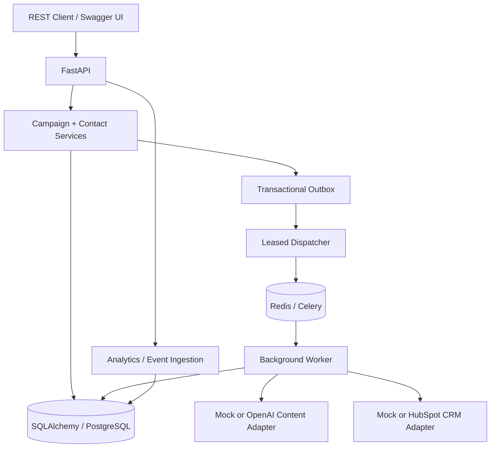

# NovaMind — Reliable AI Marketing Automation Backend

**Software Engineering Portfolio | Python · FastAPI · SQLAlchemy · Alembic · PostgreSQL · Celery · Redis**

NovaMind is a **safe-by-default backend reference project** for AI-assisted marketing workflows for creative agencies. It demonstrates API design, persistence, versioned content, simulated campaign dispatch, event-based analytics, and failure-aware task processing.

> **Project status:** SDE 2.2, locally validated. **No real marketing emails are sent.** Third-party integrations are optional and opt-in. PostgreSQL/Celery multi-worker deployment, real external API access and production security have **not** been end-to-end verified. See [validation details](docs/validation_v22.md).

## Features

| Capability | Implementation |
| --- | --- |
| Campaign lifecycle | REST API, explicit approval, state-specific retry and execution history |
| AI content | Typed content schema, deterministic mock provider; optional OpenAI adapter |
| Contact segments | Ops Leads, Creative Directors, Freelancers; fictional `.test` sample dataset |
| Data correctness | Immutable recipient Persona snapshots, consent suppression, event deduplication |
| Database | SQLAlchemy models, explicit Alembic migrations `0001`–`0003`, SQLite demo and PostgreSQL deployment configuration |
| Background processing | Celery/Redis and leased Outbox with fencing, bounded retry and recovery design |
| Analytics | Delivered/open/click/unsubscribe counts; null rates when denominators are unknown |
| Developer workflow | pytest, GitHub Actions, Dockerfile, Docker Compose, ADRs and operating docs |

## Architecture



`MockMailer` is the only mailing implementation. It does **not** deliver email. The system is a reference implementation, not a production marketing platform or proof of exactly-once execution.

## Quick start — no external credentials

Python 3.11+ is required. From the repository root:

```bash
python3 -m venv .venv
source .venv/bin/activate          # Windows PowerShell: .venv\Scripts\Activate.ps1
pip install -e '.[dev]'
cp .env.example .env               # Windows PowerShell: Copy-Item .env.example .env
python -m pytest -q
python -m app.cli demo
uvicorn app.main:app --reload
```

Open [Swagger UI](http://127.0.0.1:8000/docs). The local development token is `dev-only-change-me`; never use this token on an Internet-facing host.

```bash
curl -X POST http://127.0.0.1:8000/api/v1/campaigns \
  -H 'Authorization: Bearer dev-only-change-me' \
  -H 'Idempotency-Key: github-demo-001' \
  -H 'Content-Type: application/json' \
  -d '{"topic":"AI in creative automation","personas":["ops_lead","freelancer"]}'
```

## Local multi-service configuration (not E2E validated)

```bash
docker compose up --build
docker compose exec api python -m app.cli seed
```

Docker Compose defines PostgreSQL, Redis, migrations, API, Celery Worker, leased Outbox Dispatcher and Recovery Supervisor. It binds the development API to localhost. **Do not expose this Compose environment publicly.** See [runbook](docs/runbook.md) and [security notes](SECURITY.md).

## Testing and engineering evidence

- Local baseline: **34 pytest tests passed; approximately 80% overall coverage** (measured for the SDE 2.2 release before GitHub publication). This is not a claim that cloud CI, all Docker services or multi-worker recovery have passed.
- Migration tests cover SQLite upgrades from v2.0/v2.1 fixtures and Alembic schema-drift checks. The PostgreSQL migration and race testing remain future work.
- Historical imported recipient profiles are explicitly marked as **unverified backfills**; current contact information is not represented as authenticated historical consent.
- Coverage does not establish distributed-systems correctness; see [limits](docs/validation_v22.md), [failure injection](docs/failure_injection.md) and the [next roadmap](docs/roadmap_v23.md).

## Structure

```text
app/                  FastAPI, schemas, domain services, provider adapters, workers
alembic/              Database migrations 0001–0003
tests/                Unit / API / regression / mock integration tests
data/sample_contacts.csv  Fictional .test contact data only
docs/                 Architecture, API, ADRs, reliability and validation
.github/workflows/ci.yml  GitHub Actions CI
Dockerfile, docker-compose.yml, pyproject.toml, .env.example
```

## Documentation

[Architecture](docs/architecture.md) · [API reference](docs/api.md) · [Reliability design](docs/reliability_design.md) · [Schema migration](docs/migration_0003.md) · [Testing](docs/validation_v22.md) · [Security](SECURITY.md) · [Roadmap](docs/roadmap_v23.md) · [Changelog](CHANGELOG.md)


## Data, publishing, and license notes

The public repository contains **fictional `@example.test` contacts only**. Original source contacts, old project backups, real `.env` files, credentials, local databases and caches are excluded. Recheck files and Git history before using the project with real data. This repository ships **without an open-source license**; the repository owner should choose a license explicitly if they want to grant redistribution/modification rights.
