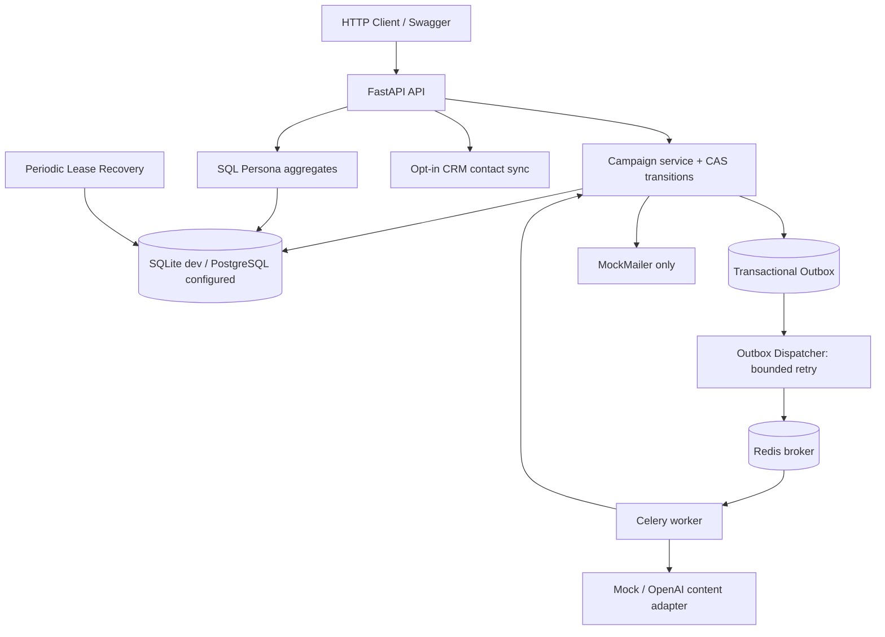

> **2.2 note:** This document originated in version 2.1. See `README.md`, `docs/upgrade_v22.md` and `docs/validation_v22.md` for current 2.2 behavior and evidence.

# NovaMind SDE 2.1 — Technical Architecture

## Intent and bounded functionality

A modular-monolith backend provides campaign management, deterministic mock content, opt-in OpenAI generation, contact handling, **mock-only newsletter dispatch**, synthetic events and metrics. The three original personas are preserved. This release fixes previously reproduced execution and data consistency defects without adding unsupported live email delivery.

## Request and background architecture

## Lifecycle and execution correctness

```mermaid
stateDiagram-v2
    [*] --> QUEUED
    QUEUED --> GENERATING
    GENERATING --> REVIEW_REQUIRED
    GENERATING --> FAILED
    REVIEW_REQUIRED --> APPROVED: Human review
    REVIEW_REQUIRED --> QUEUED: Revise content
    APPROVED --> QUEUED: Revise content
    APPROVED --> DISPATCH_QUEUED: Request dispatch in Celery mode
    APPROVED --> DISPATCHING: Inline mode
    DISPATCH_QUEUED --> DISPATCHING
    DISPATCHING --> COMPLETED
    DISPATCHING --> FAILED
    FAILED --> QUEUED: Retry generation failure
    FAILED --> DISPATCH_QUEUED: Retry dispatch failure
    GENERATING --> QUEUED: Expired lease; attempts available
    DISPATCHING --> DISPATCH_QUEUED: Expired lease; attempts available
```

Generation and mock Dispatch each have a separate attempt budget. Every claim stores a new execution token and an audit record. Workers can update a stage only if the DB still has their token; a supervisor may fence a stale worker after lease expiry. Approval pins a particular content version, and `/revise` requires fresh approval.

## Data model

- `campaigns`: topic, requested personas, status, stage-specific attempts, approval version, execution token, lease, failure classification.
- `content_versions`: numbered, append-only content revisions per campaign.
- `execution_attempts`: per-stage attempt audit, timestamps and status.
- `contacts`: static persona, consent bit, persistent suppression reason and timestamp.
- `campaign_recipients`: one row per campaign+contact, mock send/suppression state.
- `delivery_events`: synthetic source, globally unique provider event ID, typed events.
- `outbox_events`: durable task intent, publish attempts, next attempt time, status.
- `performance_summaries`: deterministic source-aware interpretation.

## Correctness tradeoffs and limits

- Inline mode is deterministic but can block an HTTP request. Celery mode is configured but real Redis/Celery/Postgres operation is **not verified in this local release**.
- Outbox means at-least-once publication; broker messages can duplicate after dispatcher crash. Compare-and-swap avoids duplicate **DB state transition**, not exactly-once external side effects.
- Recovery runs periodically in Compose after the database lease expires, without heartbeat. It cannot know whether an unverified real provider accepted a send. Thus live marketing email is absent by design.
- Synthetic demo engagement never proves actual email delivery. Unique recipient event aggregates avoid the original random-rate and denominator inconsistencies.
- Authentication uses a single development Bearer token; real multi-tenant RBAC, IAM, webhook signature verification, provider outcome reconciliation, SLOs and cloud production rollout remain future work.

See `reliability_design.md`, `schema_evolution.md`, `security.md` and `test_plan.md` for detailed reasoning.
